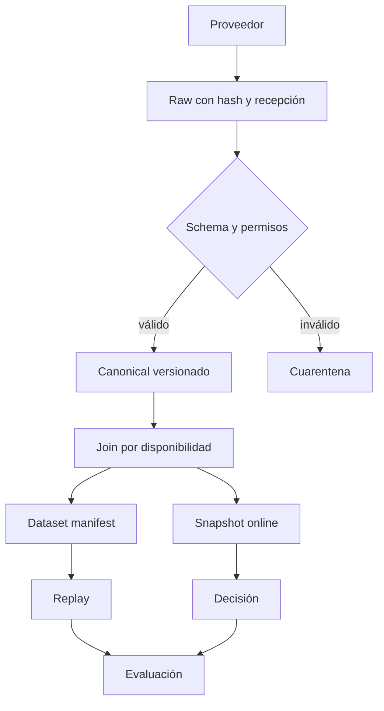

# Flujo de datos

Vista de diseño. Las relaciones financieras y estados normativos se detallan en los contratos y documentos de dominio. Ninguna flecha implica autorización live ni servicio ya desplegado.
