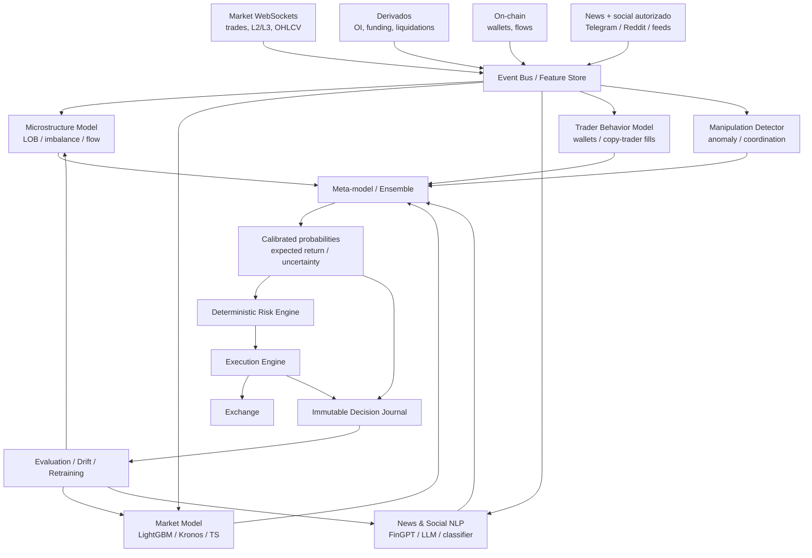
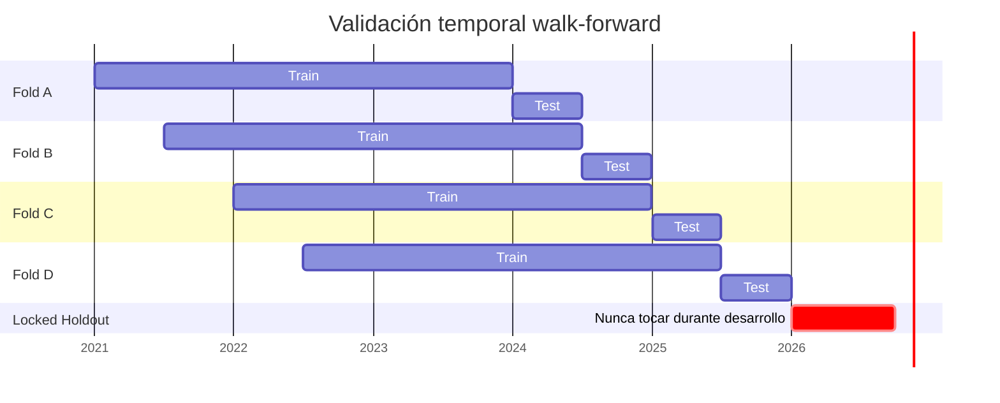

# IA para trading autónomo multimodal: estado del arte, fuentes, arquitectura y plan de validación

## Resumen ejecutivo

La idea central —combinar **datos de mercado, order book, operaciones de traders observables, noticias, información on-chain, foros, Telegram y modelos de IA**— es técnicamente viable y coincide con una dirección real de la investigación cuantitativa moderna: *signal fusion*, *ensemble learning*, modelos multimodales y agentes especializados. La evidencia, sin embargo, no respalda la conclusión de que «más IA + más fuentes = trading fácil». Desde comienzos de siglo, la automatización redujo muchas ineficiencias simples y aumentó la competencia algorítmica; Hendershott, Jones y Menkveld documentaron ya en 2011 cómo el crecimiento del trading algorítmico estaba asociado con menores spreads y mayor informativeness de las cotizaciones en acciones grandes. citeturn859479search0turn859479search1

Hay, aun así, evidencia concreta de señales explotables. Lo, Mamaysky y Wang mostraron en 2000 que algunos patrones técnicos contenían información incremental cuando se definían algorítmicamente en vez de «a ojo». DeepLOB y otros trabajos posteriores demostraron capacidad predictiva fuera de muestra a partir de libros de órdenes. En 2025, Haase et al. analizaron 28.700 recomendaciones explícitas de X, Reddit, Stocktwits y Telegram y encontraron asociación con retornos anormales de corto plazo; el efecto era más fuerte inmediatamente después de la señal y en determinadas criptomonedas de menor capitalización. citeturn789942search0turn859479search5turn454788search1

También existe el reverso: las mismas redes sociales albergan *pump-and-dumps*, *shilling*, bots y señales manipulativas. Un trabajo de 2026 sobre más de 20 millones de mensajes de 14.499 canales públicos de Telegram encontró eventos compatibles con manipulación cuya coordinación podía preceder movimientos de precio por segundos; además, el lenguaje manipulativo resultó difícil de distinguir del orgánico usando solamente texto. citeturn454788academia7

Por eso, el proyecto recomendable para Santiago no es un «LLM que decide Buy/Sell», sino un **laboratorio cuantitativo autónomo** con tres capas separadas: inteligencia probabilística, riesgo determinista y ejecución determinista. FreqAI ya ofrece reentrenamiento adaptativo y backtesting temporal; Hummingbot Condor adopta explícitamente una separación entre razonamiento LLM y ejecución determinista; QuantConnect/LEAN ofrece una infraestructura madura para investigación y ejecución algorítmica. citeturn768867search0turn768867search2turn768867search4

La hipótesis clave debería formularse así:

> **H₁:** una combinación temporalmente correcta de señales de mercado + microestructura + social/news + on-chain + comportamiento de traders mejora de manera estadísticamente significativa la expectativa neta ajustada por riesgo frente a un modelo de mercado solo y frente a un benchmark pasivo.

La hipótesis debe poder **fracasar**. Si después de costos, *slippage*, latencia, *walk-forward* y datos realmente no vistos la mejora desaparece, no existe ventaja demostrada.

El material previo aportado por Santiago ya converge con esa arquitectura multiagente y con la necesidad de separar riesgo de razonamiento probabilístico; también recoge correctamente que un experimento de siete días y 35 operaciones no basta para demostrar rentabilidad persistente. fileciteturn0file0 fileciteturn0file1

## Objetivos, alcance y criterio de éxito

### Qué cubre este informe

El objetivo es determinar **qué piezas tienen evidencia suficiente para justificar un sistema de trading autónomo**, cuáles conviene investigar experimentalmente y cuáles son principalmente marketing, folklore o demasiado costosas para un operador individual.

Se cubren investigaciones de 2000–2026 sobre patrones, trading algorítmico, microestructura, deep learning, social signals, Telegram y manipulación; perfiles de traders y fondos con resultados documentados; copy trading; fuentes de noticias, foros y canales; herramientas y modelos; arquitectura; metodología estadística; riesgos regulatorios y un plan de 90/180/365 días.

No se propone scraping no autorizado, adquisición de información robada, evasión de accesos, front-running ilícito, spoofing ni uso de material privilegiado. La «deep web» se considera solamente en su sentido legal: páginas no indexadas, repositorios privados autorizados, feeds autenticados, bases de datos de pago y comunidades a las que el usuario tenga acceso legítimo.

### La ventaja que realmente buscamos

La métrica objetivo no debe ser el *win rate*. Debe ser una expectativa neta:

\[
E = p_w\bar{W}-(1-p_w)\bar{L}-C_{fees}-C_{slippage}-C_{impact}-C_{infra}
\]

Un sistema con 40 % de aciertos puede ser excelente si sus ganancias son mucho mayores que sus pérdidas; uno con 80 % puede quebrar si las pérdidas ocasionales son enormes.

Además, el sistema debe superar al benchmark relevante. El experimento con Claude aportado por Santiago es una advertencia útil: el bot relatado ganó aproximadamente 13 % en una semana, pero Bitcoin subió aproximadamente 21 % en el mismo período y el backtest posterior resultó negativo. fileciteturn0file1

La decisión de producción debería basarse al menos en cinco condiciones: expectativa neta positiva, drawdown aceptable, Sharpe/Sortino suficientemente altos, estabilidad entre regímenes y evidencia de que la ventaja sobrevive fuera de muestra.

## Estado del arte y qué aprender de los mejores traders

### Evolución desde los años 2000

En 2000, Lo, Mamaysky y Wang formalizaron patrones como *head-and-shoulders* o *double bottoms* mediante regresión no paramétrica y encontraron que varios contenían información incremental sobre retornos. Esto valida una parte de la intuición histórica del análisis técnico, pero no significa que cualquier patrón visual sea rentable después de costos. citeturn789942search0turn789942search2

Durante la década siguiente, el foco pasó hacia automatización y microestructura. Hendershott et al. encontraron que la automatización del NYSE incrementó el trading algorítmico y, especialmente en acciones grandes, redujo spreads y adverse selection. El mensaje para este proyecto es importante: **los mercados actuales son más eficientes precisamente porque ya compiten algoritmos entre sí**. citeturn859479search1

Desde 2018–2019, DeepLOB y trabajos relacionados mostraron que redes convolucionales y recurrentes pueden aprender estructuras predictivas del libro de órdenes. DeepLOB combinó convoluciones para la geometría del LOB y LSTM para dependencias temporales y reportó estabilidad fuera de muestra sobre datos de la London Stock Exchange. citeturn859479search5

La investigación social se volvió especialmente relevante en cripto. Nghiem et al. mostraron que señales de mercado y sociales pueden ayudar a detectar *pump-and-dumps* organizados mediante Telegram. En 2024, Inuduka et al. encontraron relaciones temporales entre sentimiento de Telegram/X y Bitcoin. En 2025, Haase et al. dieron un paso adicional: en vez de «sentimiento general», extrajeron recomendaciones explícitas Buy/Sell y observaron poder predictivo de corto plazo, concentrado cerca del instante de publicación. citeturn454788search6turn454788search5turn454788search1

En manipulación y microestructura, Fabre y Challet propusieron en 2025 un detector probabilístico de *spoofability* utilizando variables de flujo de órdenes y Hawkes multiescala; su análisis subraya que la distancia de colocación de las órdenes importa para interpretar el libro. Un trabajo de 2026, SD-FMM, combinó aprendizaje autosupervisado y features de microestructura para detectar manipulación en acciones y cripto. citeturn454788search2turn454788search3

### Traders, scalpers y fondos

No existe una base pública comparable con ROI y drawdown auditados de «los mejores scalpers del mundo». La mayoría de los casos individuales famosos tienen resultados parcialmente documentados, entrevistas o estimaciones, no un *track record* público continuo. Eso obliga a separar evidencia fuerte de folklore.

| Caso | Evidencia de rendimiento | Horizonte/estilo | Drawdown público | Transparencia | Qué sirve para la IA |
|---|---|---|---|---|---|
| **Renaissance Medallion / Jim Simons** | ≈66 % anual bruto y ≈39 % neto 1988–2021 según datos publicados y reportados | Cuantitativo, múltiples horizontes | No divulgado públicamente de forma completa | Alta sobre retornos históricos; bajísima sobre estrategia | *Ensemble*, señales débiles, diversificación, modelado estadístico |
| **Edward Thorp / Princeton Newport** | ≈19–20 % anual compuesto en períodos largos, según sus publicaciones y reconstrucciones | Market-neutral, arbitraje estadístico | No serie pública completa | Media/alta | Sizing, Kelly, arbitraje, neutralidad |
| **Paul Rotter** | Resultados extraordinarios relatados en entrevistas; cifras de ingresos no auditadas | Scalping de futuros, DOM/order flow | No verificable | Baja-media | Lectura de flujo, reversión rápida, disciplina |
| **Takashi “BNF” Kotegawa** | Fortunas históricas reportadas; sin extracto auditado completo | Intradía + swing, mean reversion | No disponible | Media-baja | Reversión después de ventas extremas |
| **Binance Copy Trading** | ROI, PnL, Sharpe, MDD y win rate visibles por portfolio | Spot/copy | Sí, por trader/portfolio | Media; plataforma calcula métricas | Dataset de comportamiento, no «copiar al #1» |
| **Bybit Master Traders** | ROI y operaciones históricas/actuales expuestas según producto | Derivados/copy | Sí en rankings y métricas | Media | Análisis cross-trader y persistencia |

Medallion es el referente excepcional: fuentes que reconstruyen los datos publicados sitúan su retorno anualizado en ~66 % antes de fees y ~39 % después de fees entre 1988 y 2021; el fondo está cerrado a externos desde hace años, por lo que no es una oportunidad de copy trading. citeturn980209search0turn980209search1turn980209search2

Thorp reportó alrededor de 20 % anual durante períodos prolongados en estrategias *market-neutral/stat-arb*. Lo importante para este proyecto no es copiar sus instrumentos de hace décadas sino adoptar la lógica de **apuestas pequeñas con ventaja estimada y control riguroso del sizing**. citeturn980209search3turn980209search4

Rotter es útil como caso de microestructura, pero sus cifras de beneficios no están auditadas públicamente. Una entrevista de 2005 sí documenta que llegó a ejecutar 100–150 operaciones diarias muy temprano en su carrera y enfatizaba salir con rapidez cuando una tesis fallaba. Algunas prácticas históricamente asociadas a «flipping» hoy pueden cruzar la línea hacia *spoofing* dependiendo de la intención; no deben reproducirse. citeturn980209search6turn980209search5

Kotegawa tiene abundante cobertura histórica, pero no estados de cuenta públicos auditados. Reportes sobre la operación J-Com sitúan el beneficio cerca o por encima de ¥2.000 millones; su estilo se asocia más correctamente con *mean reversion* discrecional de corto plazo que con scalping puro. citeturn980209search7turn980209search8

Para aprender de traders contemporáneos, **Hyperliquid es técnicamente más interesante que perseguir celebridades**: su API documenta la consulta de hasta 2.000 fills recientes por dirección pública. Eso permite construir perfiles observables de wallets, aunque una dirección no revela toda la exposición económica del operador ni sus coberturas fuera de la plataforma. citeturn449373search5

Binance publica ROI, PnL, Sharpe, MDD, win rate y AUM de portfolios de copy trading; Bybit expone operaciones actuales y pasadas, entradas, cierres y ROI de Master Traders. Ambos advierten implícita o explícitamente que el rendimiento pasado no garantiza resultados futuros. citeturn449373search0turn449373search3

La mejor estrategia no es copiar al trader con mayor ROI. Es estimar **persistencia**:

\[
Skill_i = f(\text{ROI}, \text{MDD}, \text{Sharpe}, \text{edad del track record},
\text{exposición}, \text{regímenes}, \text{slippage del follower})
\]

y analizar si el rendimiento continúa después de seleccionarlo.

## Fuentes de información, Telegram, foros y noticias

### Jerarquía recomendada

La información debería clasificarse por confiabilidad y latencia, no por «cantidad de fuentes».

| Fuente | Uso | Latencia | Permiso/viabilidad | Riesgo |
|---|---|---:|---|---|
| Exchange WebSocket / L2-L3 | Precio, trades, order book | ms–s | API oficial | Bajo |
| On-chain | Flujos, wallets, smart money | segundos–minutos | Blockchain pública/API | Bajo-medio |
| Comunicados oficiales | SEC, Fed, BLS, exchanges | segundos–minutos | Público/API/feed | Bajo |
| News terminals/feed | Headlines y macro | segundos | Licencia comercial | Bajo |
| Telegram de noticias | Headlines/alertas | segundos–minutos | **Muy restringido para IA** | Alto contractual |
| Reddit | Narrativas/social | minutos | API + restricciones AI | Medio-alto |
| X | News/social | segundos | API/licencia; scraping prohibido | Alto contractual |
| Foros históricos | Ideas, patrones de narrativa | minutos–días | Depende del sitio | Medio |
| Dark web | Rumores, fraude, leaks | variable | Alto riesgo jurídico/ético | Muy alto |

### Canales útiles, pero no como señales ciegas

En Telegram priorizaría **news/on-chain**, no grupos «VIP signals».

**Tree News / Tree of Alpha** está orientado a titulares crypto/macro de alta velocidad y mantiene infraestructura propia de news. citeturn328252search10turn328252search20

**DB News / tier10k** se presenta como feed de titulares *market-moving* y diferencia entre su feed premium y el canal de Telegram demorado. citeturn328252search6

**Lookonchain** publica análisis de movimientos on-chain y mantiene canales oficiales enlazados desde sus propiedades. citeturn328252search0turn328252search16

**Whale Alert** ofrece tracking de grandes transacciones blockchain; sus alertas deben tratarse como eventos, no como «sell signal», porque una transferencia a un exchange no demuestra intención de venta. citeturn328252search46turn328252search4

La lista operativa inicial sería:

| Fuente | Variable que extraería | Prioridad |
|---|---|---:|
| Tree News | entidad, evento, activo, sorpresa, timestamp | Alta |
| DB News | macro/news/evento | Alta |
| Lookonchain | wallet/evento/flujo | Alta |
| Whale Alert | transferencia y destino | Media |
| Canales propios de Santiago con consentimiento | señal/opinión/autor/confianza | Alta como experimento |
| Canales VIP genéricos | señal + fuente + historial | Baja; solamente para evaluar |

### Foros

**r/algotrading** y **r/quant** son útiles para investigación técnica, herramientas y discusión metodológica, pero no deben usarse como «oracle» de precio.

**r/CryptoCurrency**, **r/Bitcoin**, **r/WallStreetBets** y Stocktwits son más interesantes como sensores de atención, euforia, pánico y cambio de narrativa.

**Bitcointalk** tiene valor histórico excepcional porque contiene narrativas de criptomonedas desde los primeros años del ecosistema.

**QuantConnect Community** y **Numerai** son mejores fuentes para aprender diseño cuantitativo y evaluar modelos. Numerai actualmente permite ejecutar múltiples modelos y combina predicciones participantes en su Meta Model. citeturn449373search6turn449373search7

La hipótesis de «sentimiento extremo como contrarian» debe probarse, no asumirse. La investigación disponible sobre sentimiento social muestra efectos que dependen del horizonte, activo y régimen; incluso pueden revertirse con el tiempo. citeturn454788search5

### El gran obstáculo: permisos

Aquí hay un cambio muy importante para el proyecto.

Los términos actuales de Telegram **prohíben expresamente scraping, indexación, harvesting, agregación o utilización de datos de Telegram para desarrollar, validar o desplegar IA/ML**, salvo excepciones en las que los usuarios relevantes den consentimiento explícito, informado, afirmativo y continuado dentro del contexto específico. citeturn842459search0turn842459search1

Por lo tanto, la asunción de este informe —«los canales de Santiago son utilizables con consentimiento»— debe comprobarse canal por canal. El simple hecho de pertenecer a un grupo no equivale a tener permiso para entrenar un modelo con su contenido.

Reddit también exige autorización del titular del contenido para utilizar User Content en entrenamiento de IA fuera de los usos permitidos; su API impone condiciones adicionales para usos comerciales. citeturn842459search6

X prohíbe scraping sin permiso expreso y sus licencias comerciales actuales incluyen restricciones específicas para uso de contenido en machine learning/AI. citeturn842459search5turn842459search7

Esto cambia el diseño: **no necesitamos entrenar el LLM con Telegram**. Podemos, cuando haya autorización válida, transformar cada evento entrante en features estructuradas y descartar el texto original según la política de retención apropiada. Legalmente sigue siendo necesario revisar los términos aplicables, pero reduce muchísimo la dependencia de datasets sociales masivos.

## Modelos y herramientas especializadas

### Comparativa técnica

| Tecnología | Rol óptimo | Ventaja | Limitación | Costo software |
|---|---|---|---|---:|
| **Freqtrade/FreqAI** | Crypto ML/backtest/live | Retraining, features, dry-run | No crea alpha por sí mismo | Gratis/open source |
| **Hummingbot + Condor** | Ejecución/agentes | LLM separado de ejecución determinista | Infra más compleja | Gratis/open source + infra/API |
| **QuantConnect/LEAN** | Investigación multi-activo | Dataset/backtest/framework maduro | Cloud/data pueden costar | Plan gratis + planes pagos |
| **Kronos** | OHLCV/K-line forecasting | Foundation model financiero | Forecast ≠ rentabilidad | Open source en modelos publicados |
| **FinGPT** | NLP financiero | LLM financiero abierto | Necesita dominio/datos/validación | Open source |
| **FinRL** | RL financiero | Simulación y políticas secuenciales | Fácil sobreajustar simulador | Open source |
| **Numerai** | Meta-model/tournament | Validación de modelos y ensembles | Universo/objetivo específico | Participación accesible |
| **GPT / Claude / Gemini** | extracción, research, agentes | NLP/reasoning multimodal | Latencia/costo/no determinismo | Por tokens |
| **DeepLOB-like** | Microestructura | Aprende LOB directamente | Requiere datos granulares y compute | Desarrollo propio |

FreqAI está diseñado explícitamente para entrenamiento adaptativo, generación masiva de features, reentrenamiento periódico, backtesting histórico que emula retraining y ejecución *dry/live*. Su documentación recalca que sus estrategias de ejemplo no son para producción. citeturn768867search0turn768867search1

Hummingbot Condor es especialmente alineado con esta visión porque implementa una arquitectura de dos capas: una capa agentic basada en LLM/OODA y una capa de ejecución determinista mediante Hummingbot API. Opera sobre más de 50 exchanges/blockchains según su documentación actual. citeturn768867search2turn768867search3

LEAN/QuantConnect proporciona un framework modular para *alpha*, construcción de portfolio, riesgo y ejecución; QuantConnect informa más de dos millones de algoritmos creados sobre la plataforma y actualmente mantiene un nivel gratuito con backtesting ilimitado y múltiples clases de activos. citeturn768867search4turn648373search2

**Kronos** es muy interesante para Santiago. El trabajo de 2025/AAAI 2026 preentrenó un Transformer autoregresivo específico de K-lines sobre más de 12.000 millones de registros provenientes de 45 exchanges. Los autores reportan mejoras importantes en benchmarks de forecasting, volatilidad y generación sintética. Eso merece un *benchmark*, pero no demuestra que Kronos produzca PnL positivo después de costos. citeturn490555academia9turn490555search5

FinGPT y FinRL continúan activos en AI4Finance; el repositorio oficial de FinGPT se centra en LLM/NLP financiero y FinRL en reinforcement learning para mercados. citeturn768867search5turn768867search6

### Dónde usar LLM y dónde no

Usaría GPT/Claude/Gemini para:

- convertir noticias en eventos estructurados;
- detectar entidad, activo, dirección e incertidumbre;
- comparar historias contradictorias;
- clasificar mensajes autorizados;
- resumir eventos macro;
- generar hipótesis;
- auditar decisiones después del trade.

No los usaría como único modelo que recibe «BTC chart + noticias» y responde BUY/SELL.

Para *scalping* de segundos, el modelo principal debería ser un modelo pequeño y local: LightGBM/XGBoost, red temporal, DeepLOB-like o predictor específico de microestructura. Llamar a un LLM en cada tick introduce latencia, costo e incertidumbre innecesarios.

A noviembre de 2026, los precios API cambian por modelo: por ejemplo, OpenAI lista GPT-5.6 Sol en US$4/M tokens de entrada y US$20/M de salida; Google ofrece modelos Flash/Lite considerablemente más baratos; Anthropic publica precios por millón de tokens para su familia Claude. citeturn648373search0turn648373search1turn648373search3

Para el prototipo, una arquitectura híbrida puede mantener el costo LLM en decenas de dólares/mes si únicamente procesa eventos filtrados; el gasto puede crecer rápidamente si se le envían chats completos, noticias redundantes o análisis continuo.

## Arquitectura y protocolo para demostrar ventaja

### Arquitectura propuesta

El meta-model no debería preguntar «¿sube BTC?», sino producir distribuciones:

\[
P(r_{30s}>c),\quad P(r_{5m}>c),\quad P(r_{1h}>c)
\]

junto con retorno esperado, volatilidad esperada y confianza calibrada.

### Aprender de otros traders sin copiarlos ciegamente

Cada trader/wallet público se representaría como una secuencia:

\[
T_t=(asset,side,size,entry,time,holding\ time,exit,leverage,regime)
\]

De ahí surgirían features como:

- tamaño relativo a su capital;
- concentración;
- comportamiento después de pérdidas;
- frecuencia;
- duración;
- capacidad de entrada antes de movimientos;
- performance por régimen;
- correlación con otros traders;
- persistencia de alpha.

No afirmaría que una posición grande significa que «está seguro». Puede ser hedge, arbitraje o una fracción de una estrategia que no observamos. El modelo debe hablar de **probabilidad de convicción aparente**, no de intenciones mentales.

### Diseño experimental A/B/C/D

La prueba central debe aislar el valor de cada familia de datos.

| Sistema | Datos | Pregunta |
|---|---|---|
| **A** | mercado solamente | baseline |
| **B** | mercado + microestructura | ¿LOB aporta alpha? |
| **C** | mercado + social/news/on-chain/traders | ¿la información externa agrega valor? |
| **D** | C pero señales sociales temporalmente barajadas | ¿la mejora era causal/temporal o casualidad? |

Añadiría ablaciones:

C − Telegram, C − news, C − on-chain, C − trader model.

Si quitar Telegram no perjudica resultados, Telegram no justifica su complejidad.

### Walk-forward

Ejemplo para 2021–2026:

Una vez observado el *locked holdout*, deja de ser verdaderamente oculto y debe reemplazarse por paper trading prospectivo.

### Métricas

Reportaría como mínimo:

**PnL neto**, CAGR, expectativa/trade, Sharpe, Sortino, Calmar, máximo drawdown, tiempo de recuperación, turnover, hit rate, payoff ratio, VaR/CVaR, Brier score/calibración y resultados por régimen.

Para juzgar el Sharpe usaría el **Probabilistic Sharpe Ratio (PSR)** de Bailey y López de Prado, que ajusta la confianza del Sharpe por longitud del track record, skewness y kurtosis. citeturn859479search7

Además usaría *block bootstrap* para preservar autocorrelación temporal, intervalos de confianza del PnL y pruebas de sensibilidad a:

- fees +25/50/100 %;
- slippage ×2;
- latencia adicional;
- fills parciales;
- spreads ampliados;
- caída de API;
- períodos de volatilidad extrema.

### Protocolo específico para Telegram y foros

Para cada fuente autorizada:

1. almacenar timestamp de creación **y de recepción**;
2. identificar activo;
3. clasificar tipo: news/señal/opinión/rumor;
4. extraer dirección, horizonte y nivel de confianza;
5. calcular retorno desde el precio realmente disponible al recibirlo;
6. medir retorno a 30 s, 1 m, 5 m, 15 m, 1 h, 4 h;
7. descontar costos y slippage;
8. comparar contra señales aleatorias temporalmente equivalentes;
9. estimar performance por canal y por régimen;
10. penalizar canales correlacionados/copias;
11. comprobar degradación prospectiva;
12. bloquear cualquier fuente cuyo permiso no permita uso ML.

El paper de 2025 sobre crowd signals es especialmente relevante porque encontró que el efecto más fuerte se concentraba en la hora del evento y porque detectó cuentas automatizadas entre quienes publicaban señales. citeturn454788search1

Para manipulación no bastaría con NLP. El trabajo de Telegram de 2026 encontró que mensajes manipulativos podían ser lingüísticamente similares a conversaciones orgánicas; por eso el detector debería combinar **sincronización de mensajes + volumen + order flow + wallet activity + price response**. citeturn454788academia7

## Riesgos, ingresos posibles y plan de ejecución

### Riesgo legal y operativo

Para Santiago, residente en Argentina, operar **su propio capital** no equivale a prestar un servicio PSAV. La RG 1058/2025 excluye expresamente de la definición de PSAV a quienes intercambian activos virtuales para sí mismos, a título personal. En cambio, custodiar, intercambiar, transferir o intermediar activos de terceros puede activar obligaciones regulatorias. citeturn158016search7

Argentina actualizó nuevamente el régimen PSAV mediante RG 1172 en octubre de 2026. La norma contempla requisitos patrimoniales, auditorías de sistemas, conservación de información y obligaciones operativas para quienes entren en las categorías reguladas. citeturn158016search0turn158016search8

Los PSAV también son sujetos obligados del régimen AML/FT de la UIF. citeturn158016search5turn158016search6

Por eso hay una diferencia enorme entre:

**Bot privado para tu dinero:** jurídicamente más simple.

**Vender software/SaaS:** requiere evaluar qué funciones presta realmente.

**Ejecutar dinero de clientes, custodiarlo o crear un fondo:** requiere asesoramiento jurídico/regulatorio serio antes de ofrecer el producto.

### Ingresos «pasivos» con IA

Nada de esto es realmente pasivo al comienzo. Los modelos se degradan, las APIs cambian, aparecen regímenes nuevos y las estrategias requieren monitoreo.

| Modelo | Capital requerido | Riesgo financiero | Escalabilidad | Viabilidad |
|---|---:|---:|---:|---|
| Trading propio | Bajo–alto | Muy alto | Media | Solo después de validar alpha |
| Copy-trading inteligente | Medio | Alto | Media | Interesante, pero la latencia reduce ventaja |
| Market-neutral/funding | Medio | Medio | Media | Más estructural; requiere modelar basis/counterparty risk |
| Señales premium | Bajo | Bajo financiero / alto reputacional-regulatorio | Alta | Viable si existe track record verificable |
| SaaS de analytics | Bajo-medio | Bajo | Alta | Probablemente mejor negocio inicial |
| Herramienta para evaluación de traders | Bajo-medio | Bajo | Alta | Muy alineado con el proyecto |
| Gestión/fondo cuantitativo | Alto | Muy alto | Alta | Solo con track record + estructura legal |

La dirección comercial más robusta puede acabar siendo distinta del trading propio: el mismo sistema que detecta signal quality, manipulación y wallets puede convertirse en un **terminal de inteligencia cuantitativa** para traders.

### Plan de 90 días

**Días 0–30:** construir dataset de mercado y definir tests. BTC/ETH, 1m/5m/1h; OHLCV, trades, L2, funding/OI. Implementar baseline LightGBM y reglas simples. Ningún dinero real.

**Días 31–60:** añadir microestructura y Kronos como benchmark. Introducir wallet/trader feeds públicos de Hyperliquid. Crear backtester con fees/slippage/latencia.

**Días 61–90:** añadir un pequeño conjunto de social/news legalmente utilizable. Ejecutar experimentos A/B/C/D y comenzar paper trading en tiempo real.

Costo aproximado de un POC hecho por Santiago: **US$30–150/mes** para VPS/storage/API LLM liviana si se usan datos gratuitos y open source. Datos L2/L3 históricos de alta calidad, news feeds profesionales o infraestructura de muy baja latencia pueden multiplicar el costo considerablemente.

### Plan de 180 días

Expandir a más exchanges, análisis de wallets, detección de manipulación y ensemble. Mantener varios meses de paper trading prospectivo. Introducir *champion/challenger*: el modelo nuevo nunca reemplaza al actual sin demostrar superioridad.

Presupuesto razonable de investigación individual: **US$100–500/mes**, dependiendo de almacenamiento, feeds y volumen LLM. El cuello de botella suele empezar a ser la calidad de datos, no el costo del modelo.

### Plan de 365 días

Solo si existe evidencia real:

- ejecución con capital pequeño;
- límites por exchange y estrategia;
- sin leverage inicialmente;
- incremento de capital condicionado a track record;
- auditoría automática;
- dashboard de riesgo;
- backup exchange;
- kill switch físico/lógico.

Un equipo serio para evolucionar hacia producto podría ser 3–5 personas: quant/ML, backend/data engineer, trading/execution engineer, y asesor legal/compliance part-time. Para Santiago, el MVP se puede desarrollar solo porque ya posee perfil de ingeniería/software; la incorporación de expertos tendría sentido cuando el sistema salga de laboratorio.

### Checklist previo a dinero real

- [ ] Más de un régimen de mercado en backtest.
- [ ] Walk-forward terminado.
- [ ] Holdout verdaderamente no visto.
- [ ] Varios meses de paper trading prospectivo.
- [ ] Resultado neto después de fees/slippage.
- [ ] PSR e intervalos de confianza aceptables.
- [ ] Benchmark buy-and-hold y baseline superados.
- [ ] Ninguna señal depende de información futura.
- [ ] Cada fuente social tiene permiso válido.
- [ ] LLM fuera del motor crítico de riesgo.
- [ ] Límites de pérdida diarios/semanales.
- [ ] Kill switch probado.
- [ ] Recovery tras crash probado.
- [ ] API keys sin permiso de retiro.
- [ ] Estado de posiciones persistente.
- [ ] Auditoría completa de cada decisión.
- [ ] Sin dependencia de una sola API/exchange.
- [ ] Modelo capaz de responder **NO TRADE**.

## Recomendación final y fuentes prioritarias

La visión es viable como **programa de investigación**, pero la ventaja probable no vendrá de una IA que «sepa todo». Vendrá de descubrir unas pocas señales que sean complementarias, persistentes y ejecutables.

Construiría el sistema alrededor de cuatro motores:

**microestructura**, para scalping y detección de flujo;

**información**, para noticias, eventos y social autorizado;

**behavioral intelligence**, para estudiar wallets/traders;

**meta-model**, para aprender cuándo confiar en cada motor.

La pieza decisiva sería un quinto componente: **un evaluador brutalmente estadístico que descarte modelos aunque parezcan inteligentes**.

La historia de Medallion sugiere que señales pequeñas combinadas sistemáticamente pueden producir resultados extraordinarios, pero su performance es precisamente extraordinaria y no una expectativa razonable para un nuevo sistema. citeturn980209search1 La literatura de social signals demuestra que ciertos mensajes contienen información de corto plazo; no demuestra que cualquier canal Telegram sea rentable. citeturn454788search1 Los avances como Kronos, DeepLOB, FreqAI y Condor hacen que construir este laboratorio sea hoy muchísimo más accesible que en 2000, pero no eliminan el problema central de la inversión: distinguir señal real de coincidencia estadística. citeturn490555academia9turn859479search5turn768867search0turn768867search2

Las fuentes prioritarias para continuar el proyecto deberían ser, en este orden: documentación oficial de exchanges y APIs; papers de NBER/Journal of Finance/Quantitative Finance/Electronic Markets/ICAIF/arXiv q-fin; repositorios oficiales de Kronos, AI4Finance, Freqtrade, Hummingbot y LEAN; fuentes on-chain verificables; feeds de noticias licenciados; y solamente después comunidades sociales cuyo uso esté autorizado. citeturn789942search0turn859479search1turn454788search1turn768867search5

La decisión técnica concreta sería comenzar con **BTC/ETH + datos de mercado/microestructura + wallets públicas + un conjunto mínimo de fuentes sociales autorizadas**, comparar FreqAI/LightGBM, Kronos y un modelo LOB, y no añadir otra fuente hasta demostrar mediante *ablation testing* que mejora el rendimiento fuera de muestra.

Eso preserva la ambición original —**una IA que combine mercado, traders, bots, noticias, patrones y fuentes sociales**— pero convierte la idea en algo que puede medirse, refutarse y, si realmente aparece alpha, escalarse.